# Celestial Mechanics

Course results, shown from the figures in [`figures/`](figures).

## Three bodies

Orbits of three masses. [Notebook](scripts/Problem%20sets/PS1_NCuerpos.ipynb).

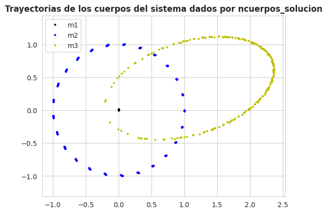

## Hierarchical system

A moon, a planet, and two stars. Paths about the barycenter, the same motion in Jacobi coordinates, and the kinetic, potential, and total energy. Playback is 2× faster than the original run. [Notebook](scripts/Homeworks/MCON_Tarea2_SistemasJerarquicos.ipynb).

| All four bodies | Each body about the barycenter |
| --- | --- |
| 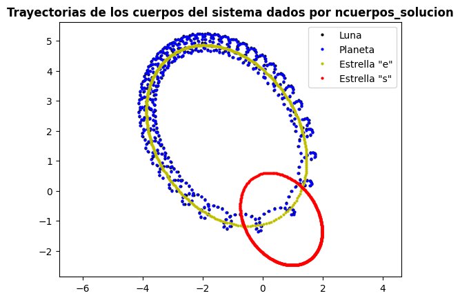 | 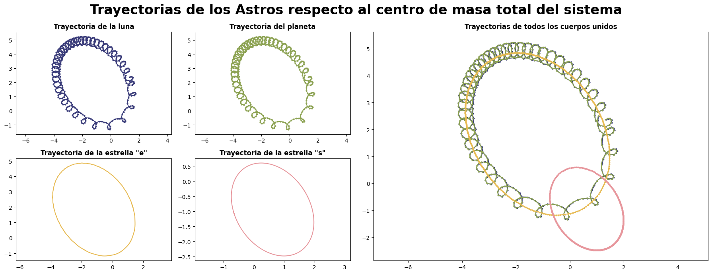 |

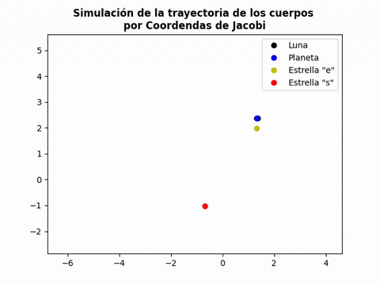

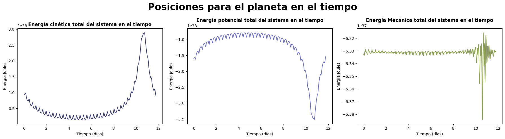

## Solar system

Planet paths about the barycenter. [Notebook](scripts/Homeworks/Bryan%20Camilo%20Restrepo%20Arcila_%20CC%201000567825_%20MCON_Tarea1_ConstantesMovimientoSistemaSolar.ipynb).

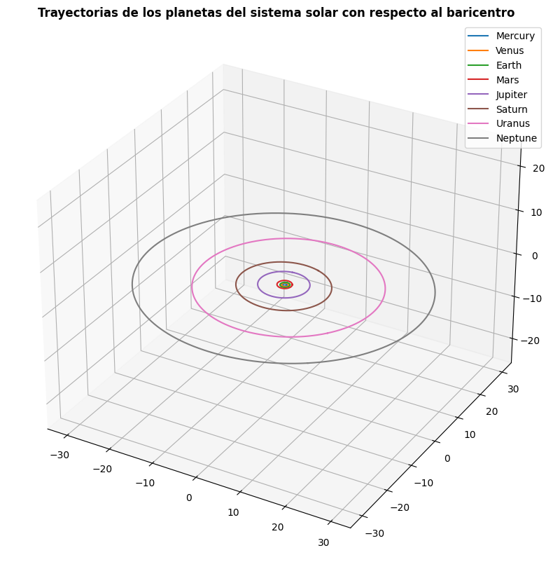

## Apophis

Earth–Apophis distance from orbital elements and from Astroquery. [Notebook](scripts/Homeworks/MC_Tarea3_AproximacionApophis.ipynb).

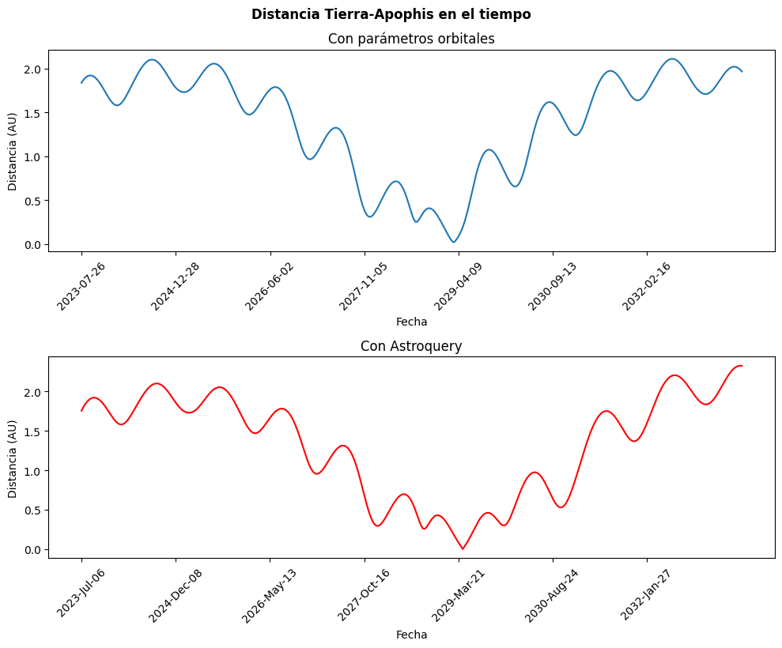

## Trip to the Moon

Approach and full transfer, in the rotating frame and in an inertial frame. [Notebook](scripts/Homeworks/MC_Tarea4_ViajeALaLuna.ipynb).

| Approach | Transfer |
| --- | --- |
| 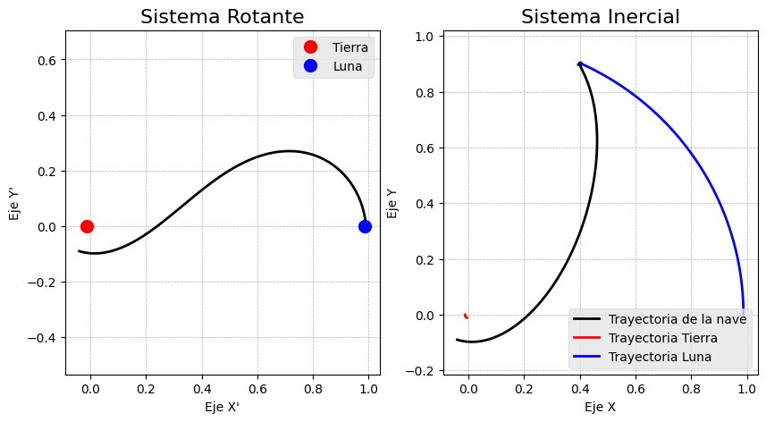 | 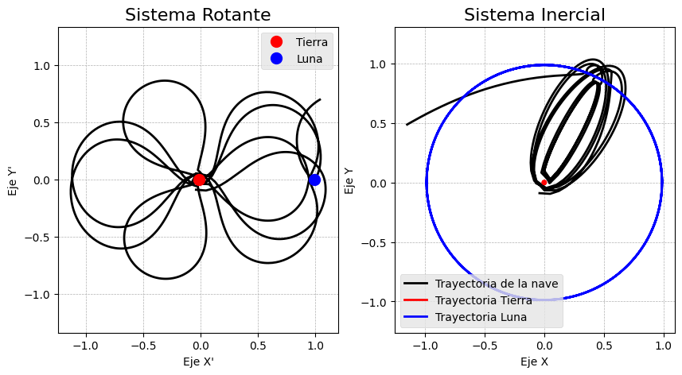 |

## Double pendulum

Same motion from the Lagrangian and from the Hamiltonian. The single pendulum is shown at 2× speed. The two pendulums with similar conditions play at the original speed. Hamiltonian contours, and the Jacobi integral along the run. [Notebook](scripts/Homeworks/MC_Tarea5y6_PenduloDoble.ipynb).

| Lagrangian | Hamiltonian |
| --- | --- |
| 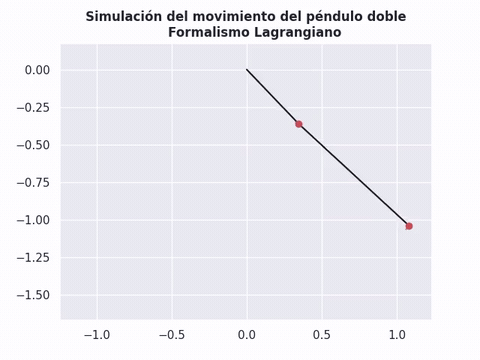 | 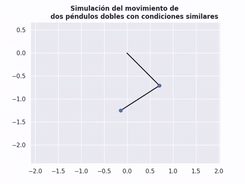 |

| Hamiltonian contours | Jacobi integral |
| --- | --- |
| 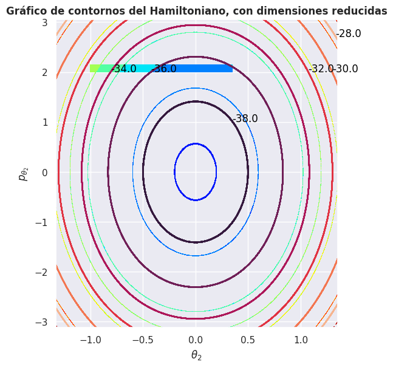 | 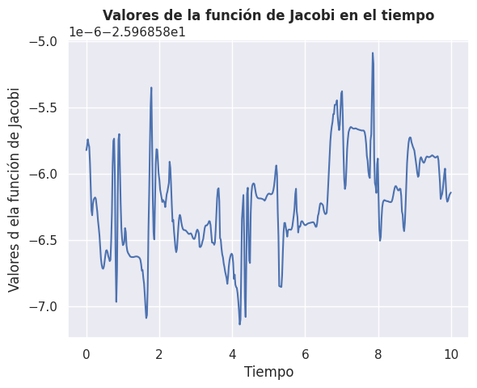 |
